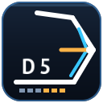
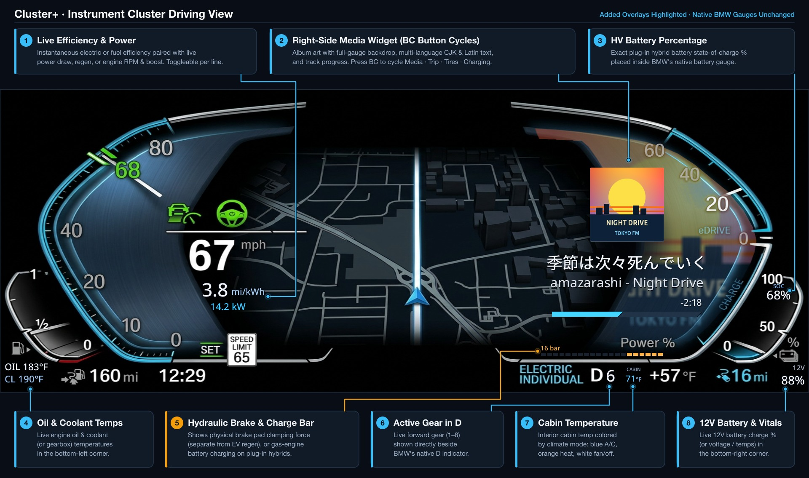
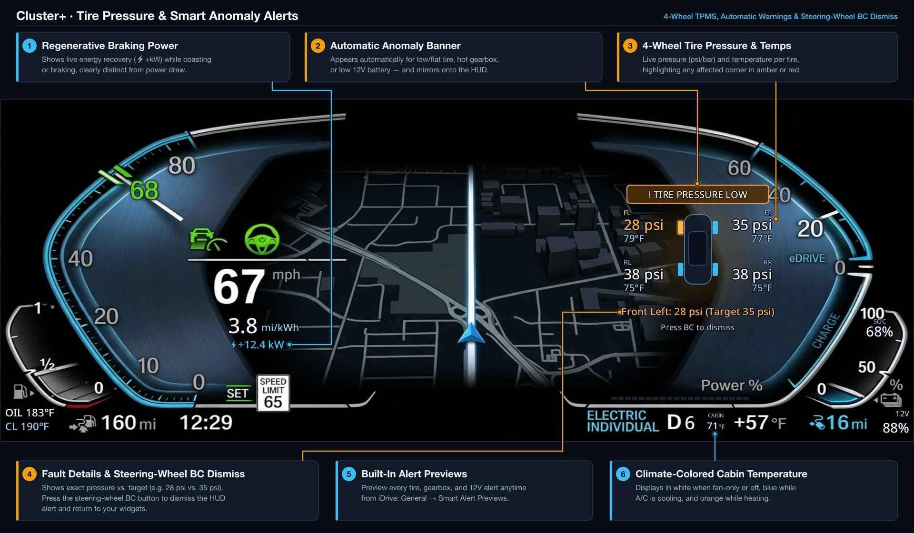
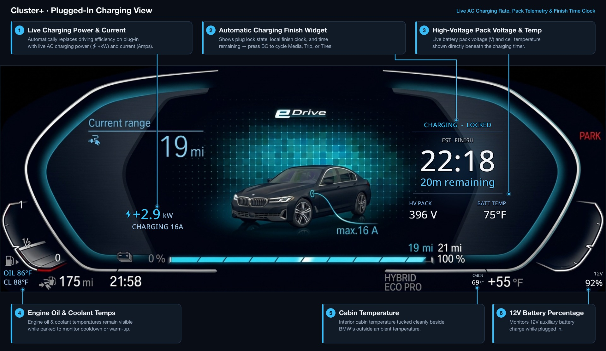
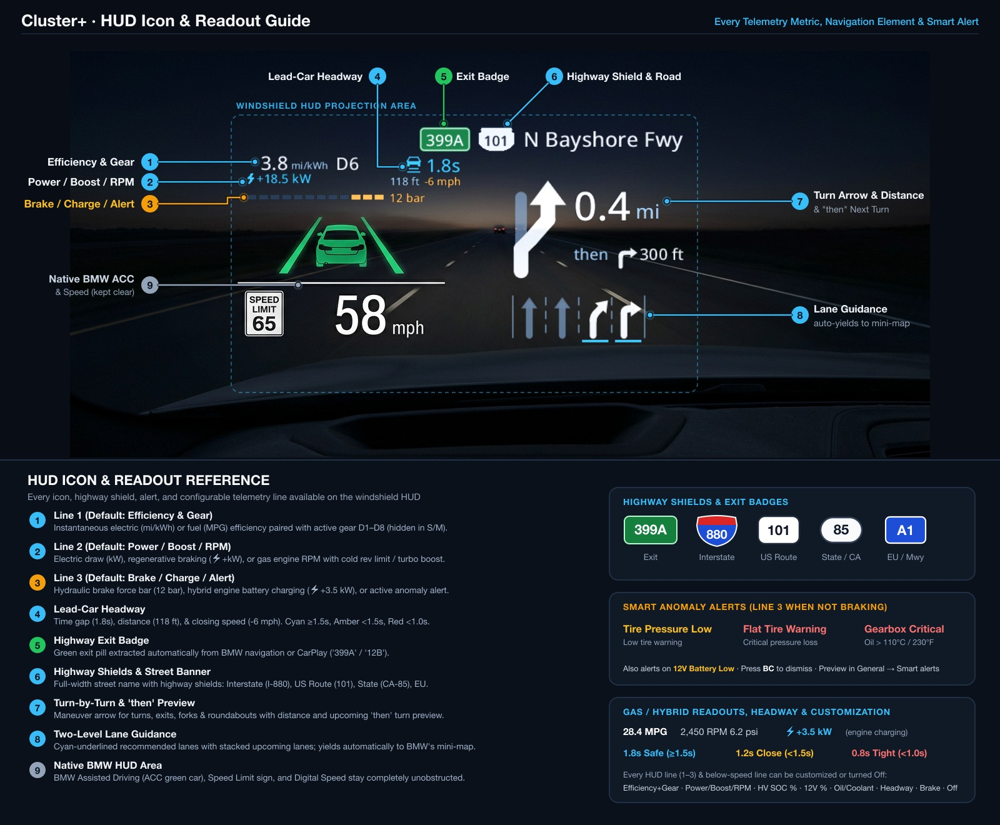

<div align="center">



# Cluster+

**A Stock+ instrument cluster & windshield HUD experience for BMW iDrive 7**


</div>

> [!WARNING]
> **Work in Progress & Safety Disclaimer**: This project is under active development — **updates are frequent and may change or break existing functionality**. It has **only been tested on a BMW G30 (530e) with iDrive 7** and is not affiliated with, endorsed by, or supported by BMW. Everything is provided **"as is"** without warranty of any kind. Modifying vehicle displays can cause unexpected behavior or driver distraction — use entirely at your own risk.

---

## Why Cluster+?

Instead of replacing BMW's Live Cockpit with a completely different aftermarket skin, **Cluster+** gives you a **"Stock+"** experience: it preserves BMW's native gauges, center navigation map, warning lights, and windshield HUD layout, while tucking extra real-time metrics and gauges into open space — both on the **instrument cluster** and on the **windshield HUD**.

<p align="center">
  
  <br />
  <em>Driving view: live efficiency &amp; power below speed, active gear (<code>D 6</code>), climate-colored cabin temp (<code>CABIN 71°F</code>), hydraulic brake force bar (<code>16 bar</code>), Oil/Coolant temps, hybrid battery <code>SOC 68%</code> inside the sub-gauge, <code>12V 88%</code>, and full-wing Now Playing widget with multi-language CJK &amp; Latin text.</em>
</p>

<p align="center">
  
  <br />
  <em>Tire Pressure &amp; Smart Anomaly Alerts: live regenerative braking power (<code>⚡ +12.4 kW</code>), 4-wheel tire pressure &amp; temperature, automatic warning banners for tire, gearbox, or 12V anomalies mirrored onto the HUD, and steering-wheel <strong>BC</strong> button dismiss.</em>
</p>

<p align="center">
  
  <br />
  <em>Windshield HUD: full-width road banner with green exit badge &amp; highway shields (<code>I-280</code>, <code>US-101</code>, <code>CA-85</code>), two-level stacked lane guidance, lead-car headway badge, and live efficiency, gear, regen power, and hydraulic brake readouts.</em>
</p>

<p align="center">
  
  <br />
  <em>Plugged-in charging view: live AC charging rate (<code>⚡ +2.9 kW / 16A</code>) below electric range, an automatic Charging Finish Time widget (<code>22:18</code>, remaining time, HV pack voltage, battery temp — BC-cyclable to Media/Trip/Tires), Oil/Coolant temps, cabin temp, and <code>12V 92%</code>.</em>
</p>

---

## HUD Icon &amp; Readout Guide

Every icon, highway shield, headway readout, and configurable metric that can appear in the windshield HUD overlay:

<p align="center">
  
</p>

---

## Features

### Instrument Cluster
- **Efficiency &amp; Live Power Under Speed**: Instantaneous electric (`mi/kWh`, `kWh/100km`, `Wh/mi`) or fuel (`MPG`, `L/100km`) efficiency paired with live EV power draw (`kW`), regenerative braking (`⚡ +kW`), or engine `RPM` with cold-engine rev limit and turbo boost (`psi`/`bar`). Each line can be toggled independently, and automatically switches to **live AC charging speed** (`⚡ +kW` &amp; Amps) while plugged in.
- **Active Gear Next to `D` &amp; Cabin Temperature**: Shows your current forward gear (`1`–`8`) directly beside BMW's `D` indicator alongside an interior `CABIN` temperature readout colored by active climate mode (blue for A/C cooling, orange for heating, white for fan-only/off).
- **Hydraulic Brake &amp; Hybrid Engine-Charging Bar**: Displays physical brake pad clamping force (separate from EV regenerative braking), switches to a live `⚡ +kW` engine-charging bar when a plug-in hybrid's gas engine is charging the battery, and hides automatically in Park.
- **Hybrid Battery `%` on Gauge &amp; Corner Vitals**: Places exact high-voltage battery `SOC %` inside the bottom-right battery gauge on PHEVs, Engine Oil &amp; Coolant (or Gearbox) temperatures in the bottom-left corner, and `12V %` (or selectable vitals) in the bottom-right corner.

### Right-Side Cluster Widgets (BC Button)
Cycle between enabled right-wing widgets directly with your steering-wheel **BC** button (including while charging):
- **Now Playing**: Album artwork with a full gauge-edge backdrop, crisp Latin &amp; CJK typography (English, Simplified/Traditional Chinese, Japanese Kanji/Kana, Korean Hangul), automatic long-title pagination, and time remaining.
- **Trip &amp; Powertrain**: Clean summary of EV range, fuel range, trip distance, gearbox oil temp, battery/intake temp, and 12V aux status.
- **Tire Pressure &amp; Smart Anomaly Alerts**: Displays live 4-wheel TPMS tire pressures and temperatures in normal driving, and switches automatically to detailed diagnostics whenever a tire pressure/temp, gearbox oil temp, or 12V battery alert triggers (previewable anytime under **General → Smart Alert Previews**). Press **BC** to dismiss the HUD alert and return to your widgets.
- **Charging Finish Time** *(automatic)*: Activates automatically whenever you plug in to charge, displaying a local finish clock, remaining time, HV pack voltage, and battery temperature.

### Windshield HUD
- **3-Line Customizable Telemetry &amp; Smart Alerts**: Put your choice of efficiency, gear, live power/boost/RPM, temperatures, `SOC %`, `12V %`, or hydraulic brake bar on the windshield, with clear anomaly alerts (`Tire Pressure Low`, `Gearbox Critical`, `12V Battery Low`, etc.) dismissible via **BC**.
- **Lead-Car Headway Badge**: Shows time gap (`1.8s`), distance (`118 ft` / `36 m`), and closing speed (`-6 mph`) above BMW's green ACC car with color-coded distance thresholds.
- **Full-Width Road, Highway Shield &amp; Exit Banner**: Uses the full top width of the HUD for long street names with green highway exit badges and highway shields (Interstate `I-880`, US Route `US-101`, State Route `CA-85`, and EU motorway plates).
- **Turn-by-Turn &amp; Two-Level Lane Guidance**: Maneuver arrow, `"then"` next-turn preview, and two-level stacked lane guidance (immediate lower row + upcoming upper row with smooth promotion animation) that works alongside CarPlay/Android Auto navigation or yields automatically to BMW's built-in intersection mini-map.

### Native iDrive Settings App
Configure everything right from the iDrive controller with a simple 3-tab menu (**General**, **Cluster**, **HUD**), a **Smart Alert Previews** sub-menu, and a live **Diagnostics** screen — no manual config file editing required.

---

## Limitations & Known Trade-Offs

Please keep these platform limitations in mind before installing:

1. **Re-Implemented Right-Side Cluster Widget**: BMW's instrument cluster automatically hides its stock right-side BC widget whenever an app renders outside the center map area. To provide full-cluster metrics without leaving the right gauge empty, Cluster+ re-implements the right-side widget itself (**Now Playing**, **Trip & Powertrain**, **Tire Pressure & Alerts**, and **Charging Finish Time**). If you prefer BMW's stock BC widgets, you can switch to **Map-Area Only** mode in **Cluster** settings (which keeps overlays inside the center area).
2. **Custom HUD Navigation Glyphs & Mini-Map Auto-Yield**: Because the HUD overlay shares the same display area as BMW's native navigation guidance, Cluster+ draws its own turn-by-turn arrow and lane-guidance glyphs rather than BMW's stock 3D graphics. When approaching complex intersections where BMW displays a detailed mini-map, Cluster+ can **automatically yield** back to the built-in HUD map (enabled by default, or configurable in the **HUD** settings tab to always yield during navigation).
3. **Vehicle Compatibility**: Built and tested on a **BMW G30 530e (iDrive 7)** with automatic PHEV / gas detection. Other iDrive 7 chassis and engine variants have not been verified yet and may show layout or sensor differences.
4. **Recommended iDrive Setting**: Turn off BMW's optional secondary digital speed readout under **CAR → Settings → Displays → Instrument panel → Second speed = Off** so the space directly under the main speedometer stays clear.

---

## Installation

Install wirelessly in the car through **[MGU Store](https://github.com/robertnisipeanu/mgu-store)** using the **[chyiz/mgu-apps](https://github.com/chyiz/mgu-apps)** store repository:

1. Make sure **MGU Store** and **`cluster-render` (`>= 0.4.0`)** (from the default `robertnisipeanu/idrive-apps` source) are installed.
2. In MGU Store, go to **Settings → Add source**, add `chyiz/mgu-apps`, and choose **Releases**.
3. Open **Store**, select **Cluster+**, and tap **Install**.

See **[chyiz/mgu-apps](https://github.com/chyiz/mgu-apps#installing-via-mgu-store)** for full wireless and offline USB installation instructions.

<details>
<summary><strong>Optional (SSH): Use Factory BMW Type Auto Font (<code>BMWTARG.ttf</code>)</strong></summary>

Out of the box, Cluster+ renders crisp 1:1 vector typography using bundled SIL OFL 1.1 Noto Sans &amp; Noto Sans CJK fonts (zero SSH required). Because BMW's factory `/mnt/dataro/dataro2` folder is restricted (`0770`) from unprivileged OAP apps and BMW's font binaries cannot be redistributed, rooted users who want 100% factory BMW `BMWTARG.ttf` / `BMWTALG.ttf` Latin/numeral letterforms can copy their own head unit's fonts once into `/var/opt/cluster-render/fonts` (persists across reboots and all future MGU Store updates):

```sh
mkdir -p /var/opt/cluster-render/fonts && \
cp /mnt/dataro/dataro2/hmi/common/font/BMWTARG.ttf /mnt/dataro/dataro2/hmi/common/font/BMWTALG.ttf /var/opt/cluster-render/fonts/ && \
chmod 755 /var/opt/cluster-render/fonts && chmod 644 /var/opt/cluster-render/fonts/*.ttf
```

Cluster+ detects them automatically on next start and displays `Font: BMW TTF` in **Live Telemetry &amp; Diagnostics**.

</details>

---

<details>
<summary><strong>Development, Local Simulator &amp; Tests</strong></summary>

```sh
git submodule update --init --recursive
npm ci
python3 vendor/cauliflowermossgrape-idrive7-apps/kit/tools/build.py --stub-sdk cluster_metrics
node test/run_tests.js
node bench/server.js
# Open http://localhost:8078
```

To build a head-unit package without the stub SDK:

```sh
python3 vendor/cauliflowermossgrape-idrive7-apps/kit/tools/build.py --omit-sdk cluster_metrics
```

</details>

---

## License

Licensed under the **GNU General Public License v3.0 (GPL-3.0)** — see [LICENSE](LICENSE).

External build-time dependencies (`vendor/cauliflowermossgrape-idrive7-apps` submodule and `jpeg-js` via npm) retain their respective upstream licenses when bundled into release packages.
