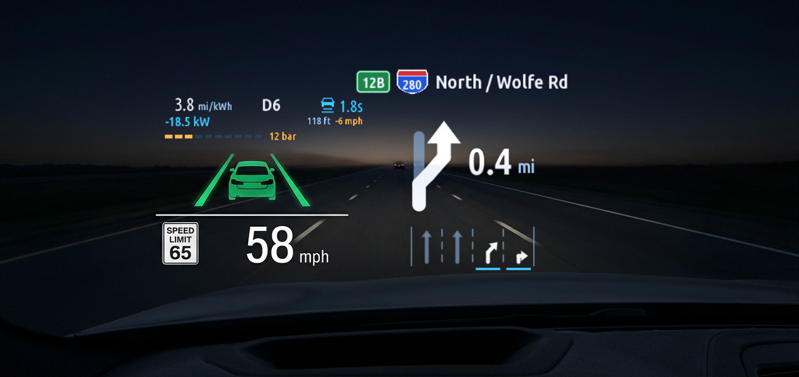

<div align="center">


# Cluster Metrics

**A Stock+ instrument cluster & windshield HUD experience for BMW iDrive 7**


</div>

> [!WARNING]
> **Work in Progress & Safety Disclaimer**: This project is under active development — **updates are frequent and may change or break existing functionality**. It has **only been tested on a BMW G30 (530e) with iDrive 7** and is not affiliated with, endorsed by, or supported by BMW. Everything is provided **"as is"** without warranty of any kind. Modifying vehicle displays can cause unexpected behavior or driver distraction — use entirely at your own risk.

---

## Why Cluster Metrics?

Instead of replacing BMW's Live Cockpit with a completely different aftermarket skin, **Cluster Metrics** gives you a **"Stock+"** experience: it preserves BMW's native gauges, center navigation map, warning lights, and windshield HUD layout, while tucking extra real-time metrics and gauges into open space — both on the **instrument cluster** and on the **windshield HUD**.

<p align="center">
  
  <br />
  <em>Driving view: live efficiency &amp; power under speed, active gear (<code>D 6</code>), friction-brake rail, Oil/Coolant temps, HV battery <code>%</code>, and full-wing Now Playing widget.</em>
</p>

<p align="center">
  
  <br />
  <em>Windshield HUD: full-width road banner with green exit badge &amp; vector highway shields (<code>I-280</code>, <code>US-101</code>, <code>CA-85</code>), lead-car headway badge, non-shifting efficiency + gear + regen power + friction-brake readout, and turn-by-turn lane guidance.</em>
</p>

<p align="center">
  
  <br />
  <em>Plugged-in charging view: live charging speed (<code>2.9 kW / 16A</code>) below the electric range, an automatic Charging Finish Time widget on the right wing, and exact HV battery <code>%</code> in the bottom-right corner.</em>
</p>

---

## HUD Icon &amp; Readout Guide

Every icon, highway shield, headway readout, and configurable metric that can appear in the windshield HUD overlay:

<p align="center">
  
</p>

---

## Features

### Instrument Cluster
- **Efficiency & Live Power Under Speed**: Real-time `mi/kWh`, `kWh/100km`, `Wh/mi`, `MPG`, or `L/100km` paired with live EV power/regen (`kW`), turbo boost (`psi`/`bar`), or cold-engine rev ceiling — automatically switching to a large **charging speed** readout (`kW` & Amps) whenever the car is plugged in.
- **Active Gear Next to `D`**: Shows your current forward gear (`1`–`8`) directly beside BMW's `D` indicator without hiding any stock icons.
- **True Friction-Brake Gauge**: Shows when your physical hydraulic brake pads are actually clamping (separate from EV regenerative braking), and hides automatically in Park.
- **Always-Visible Corner Vitals**: Engine Oil & Coolant temperatures in the bottom-left corner and HV Battery `%` (`SOC`) — or selectable vitals like gearbox oil temp, battery temp, intake air temp, or 12V voltage — in the bottom-right corner.

### Right-Side Cluster Widgets (BC Button)
Cycle between enabled right-wing widgets directly with your steering-wheel **BC** button:
- **Now Playing**: Album artwork with a full gauge-edge backdrop, English / Chinese / Japanese track and artist support, automatic long-title pagination, and time remaining.
- **Trip & Powertrain**: Clean summary of EV range, fuel range, trip distance, gearbox oil temp, battery/intake temp, and 12V voltage.
- **Charging Finish Time** *(automatic)*: Activates automatically whenever you plug in to charge, displaying estimated finish time, time remaining, charging speed, and target progress.

### Windshield HUD
- **3-Line Customizable Telemetry**: Put your choice of efficiency, gear, live power, temperatures, `SOC %`, `12V %`, or friction-brake bar / smart anomaly alerts on the glass — fixed in place so numbers never jitter, and kept clear of BMW's Speed Limit and Assisted Driving graphics.
- **Lead-Car Headway Badge**: Shows time headway (`1.8s`), physical distance (`118 ft` / `36 m`), and closing/opening speed delta (`-6 mph`) directly above BMW's green ACC car with color-coded thresholds.
- **Full-Width Road, Highway Shield & Exit Banner**: Uses the full top width of the HUD for long street names with green highway exit squares and auto-detected vector highway shields (Interstate `I-880`, US Route `US-101`, State Route `CA-85`, and EU motorway plates).
- **Turn-by-Turn & Lane Guidance**: Clean arrow, `"then"` next-turn preview, and 6-lane guidance that works alongside Waze/CarPlay HUD map projection or auto-yields to BMW's built-in intersection mini-map.

### Native iDrive Settings App
Configure everything right from the iDrive controller with a simple 3-tab menu (**General**, **Cluster**, **HUD**) plus a live **Diagnostics** screen — no manual config file editing required.

---

## Limitations & Known Trade-Offs

Please keep these platform limitations in mind before installing:

1. **Re-Implemented Right-Side Cluster Widget**: BMW's instrument cluster automatically hides its stock right-side BC widget whenever an app renders outside the center map area. To provide full-cluster metrics without leaving the right gauge empty, Cluster Metrics re-implements the right-side widget itself (currently **Now Playing**, **Trip & Powertrain**, and **Charging Finish Time**). If you prefer BMW's stock BC widgets, you can switch to **Map-Area Only** mode in **Cluster** settings (which keeps overlays inside the center area).
2. **Custom HUD Navigation Glyphs & Mini-Map Auto-Yield**: Because the HUD overlay shares the same display area as BMW's native navigation guidance, Cluster Metrics draws its own turn-by-turn arrow and lane-guidance glyphs rather than BMW's stock 3D graphics. When approaching complex intersections where BMW displays a detailed mini-map, Cluster Metrics can **automatically yield** back to the built-in HUD map (enabled by default, or configurable in the **HUD** settings tab to always yield during navigation).
3. **Vehicle Compatibility**: Built and tested on a **BMW G30 530e (iDrive 7)** with automatic PHEV / gas detection. Other iDrive 7 chassis and engine variants have not been verified yet and may show layout or sensor differences.
4. **Recommended iDrive Setting**: Turn off BMW's optional secondary digital speed readout under **CAR → Settings → Displays → Instrument panel → Second speed = Off** so the space directly under the main speedometer stays clear.

---

## Installation

Install wirelessly in the car through **[MGU Store](https://github.com/robertnisipeanu/mgu-store)** using the **[chyiz/mgu-apps](https://github.com/chyiz/mgu-apps)** store repository:

1. Make sure **MGU Store** and **`cluster-render` (`>= 0.4.0`)** (from the default `robertnisipeanu/idrive-apps` source) are installed.
2. In MGU Store, go to **Settings → Add source**, add `chyiz/mgu-apps`, and choose **Releases**.
3. Open **Store**, select **Cluster Metrics**, and tap **Install**.

See **[chyiz/mgu-apps](https://github.com/chyiz/mgu-apps#installing-via-mgu-store)** for full wireless and offline USB installation instructions.

---

<details>
<summary><strong>Development, Local Simulator &amp; Tests</strong></summary>

```sh
git submodule update --init --recursive
npm ci
python3 vendor/cauliflowermossgrape-idrive7-apps/kit/tools/build.py --stub-sdk cluster_metrics
node test/run_tests.js
node bench/server.js
# Open http://localhost:8078
```

To build a head-unit package without the stub SDK:

```sh
python3 vendor/cauliflowermossgrape-idrive7-apps/kit/tools/build.py --omit-sdk cluster_metrics
```

</details>

---

## License

Licensed under the **GNU General Public License v3.0 (GPL-3.0)** — see [LICENSE](LICENSE).

External build-time dependencies (`vendor/cauliflowermossgrape-idrive7-apps` submodule and `jpeg-js` via npm) retain their respective upstream licenses when bundled into release packages.
